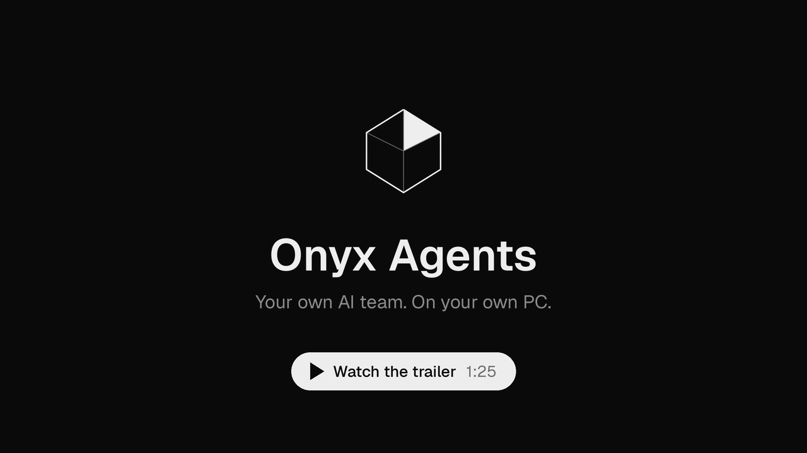

# Onyx Agents


Onyx Agents, by GK Labs, is Onyx rebuilt as a system of AI agents that run on your own PC. The models are real
open-weight **Qwen** models served locally by [Ollama](https://ollama.com); "Onyx" is the name and the look. Kimi
(Moonshot AI) is an optional cloud model, off unless you turn it on.

This folder is separate from the Onyx 3 site at the top of the repository, which is unchanged.

**Status:** built: the model layer, the agent runtime with subagents, tools, reminders, MCP connectors, the web
app, WhatsApp, SMS, sign-in and push notifications. iMessage is not planned: it needs a Mac.

<a href="https://gkson-lab.github.io/onyx/trailer/"></a>

**[Watch the trailer](https://gkson-lab.github.io/onyx/trailer/)** (1:25): filmed from the real app on a 4-core processor
with no graphics card, with the waits for the model sped up, and marked as sped up.

Onyx Agents' page on the website: **[gkson-lab.github.io/onyx/intro](https://gkson-lab.github.io/onyx/intro/)**.

## Quick start on Windows

1. Download this repository: `git clone https://github.com/gkson-lab/onyx` (or GitHub's "Download ZIP").
2. In the `agents` folder, double-click **Setup Onyx**. It installs what is missing (Node.js, Git and Ollama, through
   winget), builds Onyx, asks you for a password, picks the models for your PC, downloads them, and puts an
   **Onyx** shortcut on your desktop. Last, it asks whether Onyx should start by itself when you sign in to Windows.
   If it installs a program, it asks you to run it once more. A model that cannot be downloaded does not stop it:
   that tier uses the next smaller model that is there, and Setup says why (see [If Setup stops](#if-setup-stops)).
3. Double-click the **Onyx** shortcut to start. It restarts Ollama with the settings worked out for your PC, starts
   Onyx and opens it in your browser; keep the black window open while you use it.
4. **It updates itself.** While it runs, Onyx checks GitHub every 10 minutes and, when there is a new version and
   no agent is working, installs it and restarts (see [Updates](#updates)). **Update Onyx** does the same by hand,
   with Onyx closed.

### If Setup stops

The reason is in its window, and everything the model step said is in `data\setup-log.txt`. Setup is safe to run
again: what was downloaded stays, and a download carries on where it stopped. A download the network cuts off is
tried again by itself, twice, before Setup gives up on it.

| The message | What to do |
|---|---|
| `requires a newer version of Ollama` | update Ollama (`winget upgrade Ollama.Ollama`, or download it again from ollama.com), then run Setup again |
| `needs about N GB, and only M GB is free` | free space on the drive it names (Ollama keeps its models in `.ollama\models` in your user folder), then run Setup again |
| `The download was cut off` | check the internet connection and run Setup again |
| `Ollama is not answering` | open Ollama from the Start menu, then run Setup again |
| `Setup could not download any model` | the lines under it say why for each model; fix the first and run Setup again |

Setup stops only when no model at all could be had. When some could, Onyx works with them, and the Models screen
(More models, Download, then **Use for...**) gets the rest later.

Your PC's own settings live in files updates never touch: `.env` (password and keys), `data/` (chats, memories,
settings) and `config/*.local.yaml` (your model choices, and any connectors or prices of your own).

## Run it

You need [Node 22.13 or newer](https://nodejs.org), [pnpm](https://pnpm.io) and [Ollama](https://ollama.com).

```bash
# 1. The models (about 40 GB of downloads in all; start with the first two if you want to try it sooner)
ollama pull qwen3:4b-instruct
ollama pull qwen3:8b
ollama pull gpt-oss:20b
ollama pull qwen3:30b
ollama pull gemma3:12b          # optional: reads attached images

# 2. Onyx
cd agents
pnpm install
cp .env.example .env
pnpm models:sync     # checks every model in config/tiers.yaml against what Ollama really has
pnpm build           # builds the web app (once, and again after pulling changes)
pnpm start           # the server and the app, on http://127.0.0.1:8787
node scripts/launcher.mjs  # the same, restarting itself after an update
pnpm onyx chat       # or talk to it in the terminal
pnpm test            # 126 tests, no model or network needed
```

Optional: `ollama pull qwen3-embedding:0.6b` lets Memory recall by meaning, not only by matching words. The Coder's
sandbox needs [Docker Desktop](https://www.docker.com/products/docker-desktop/) running; without it the Coder says
the code was not run.

Onyx only runs while this PC is on and Ollama is running.

## Which models your PC can run

```bash
pnpm onyx hardware            # reads your graphics card and memory, and recommends a model for each tier
pnpm onyx hardware --apply    # and saves them in config/tiers.local.yaml
```

It works out each model's memory (weights, plus the context's cache, plus working memory) against your graphics
card and then your system memory, and estimates speed from memory bandwidth. The Models screen shows the same, with
a button to use the recommendation. The speeds are estimates, give or take 40%: `ollama run qwen3:14b --verbose`
measures the real one. Pass `--vram 16 --ram 32 --ram-speed 6000` to override what it detects.

**Ollama's settings.** Ollama reads its settings only when it starts, so the Onyx shortcut closes any copy that is
already running and starts it again with the settings worked out for your PC (`pnpm onyx ollama-env` prints them).
If you start Ollama some other way, set them first. On a 16 GB card:

```powershell
setx OLLAMA_CONTEXT_LENGTH 16384
setx OLLAMA_FLASH_ATTENTION 1
setx OLLAMA_KV_CACHE_TYPE q8_0
setx OLLAMA_MAX_LOADED_MODELS 3
setx OLLAMA_GPU_OVERHEAD 1073741824
```

Then quit Ollama from the tray and start it again. What each one does:

- `OLLAMA_CONTEXT_LENGTH`: how much each model reads at once. Without it, Ollama may give 4,096 tokens and, when a
  conversation is longer, silently drop its beginning, so an agent loses its instructions and fails.
- `OLLAMA_FLASH_ATTENTION` and `OLLAMA_KV_CACHE_TYPE`: keep that context's cache at half the memory, so Lite and
  Standard fit on a 16 GB card together (about 11 GB at 16,384 tokens).
- `OLLAMA_MAX_LOADED_MODELS`: how many models may stay loaded at once.
- `OLLAMA_GPU_OVERHEAD`: keeps 1 GB of the card free for Windows and your browser, so a model that does not fit is
  split with system memory instead of failing to load.

## When a model call fails

The Models screen counts each model's tries and failed tries, and has two sections that say why:

- **Failed tries:** the latest 20, each with what Ollama or the model said. `pnpm onyx errors` prints the same. A
  failed try is retried, then the next model is tried, then the tier below, so most still end in an answer.
- **Ollama:** whether it is running, which models are loaded, how much context each was given and how much of each
  is on the graphics card. It warns when Ollama runs without Onyx's settings, and when a model that should fit on the
  card is partly in system memory, which makes it several times slower.

| The message | What it means | What to do |
|---|---|---|
| `no answer within … ms` | the model was too slow: loading, sharing the card, or partly in system memory | start Onyx with the shortcut, so Ollama has its settings; close games and other programs that use the graphics card |
| `(not tried again: the agent's time budget had … s left)` or `out of time` | the agent had used its time, so another try could only fail | ask again; for long tasks, raise that agent's time budget on the Agents screen |
| `its tool call was lost with thinking switched off (an Ollama bug …); asked again with thinking on` | Ollama 0.40 drops a tool call Qwen3 writes with thinking off (it takes the start of `<tool_call>` for a `<think>` tag) | nothing: Onyx asks again at once with thinking on, and the call comes through. This was most of the qwen3:8b failures |
| `the stream ended with thinking but no answer` | the same Ollama bug, after the model's thinking: it happens about one time in three | nothing: it is tried again, and usually comes through on the next try |
| `HTTP 500: … out of memory` | the graphics card was full | close other programs that use it, and try again |
| `could not reach http://127.0.0.1:11434/v1` | Ollama is not running | start Onyx with the shortcut |
| `HTTP 404: … not found` | the model is not downloaded | `ollama pull` it, or run Setup again |

## Tiers

`config/tiers.yaml` maps each tier to a model. Edit it to swap models; no code changes.

| Tier | Used for | Default model |
|---|---|---|
| Lite | routing, quick replies, formatting | `qwen3:4b-instruct` |
| Standard | normal chat, summaries | `qwen3:8b` |
| Pro | coding, tool use, planning | `gpt-oss:20b` (OpenAI), then `qwen3:14b` |
| Max | hardest reasoning, with thinking on | `qwen3:30b` |
| Images | reads attached images and describes them for the others | `gemma3:12b` (Google) |

These defaults suit a graphics card with 16 GB (an RTX 5060 Ti 16 GB, for one): Lite and Standard stay on the card
together; gpt-oss 20B, a mixture of experts that uses 3.6B of its weights per token, all but fits on the card alone;
and the 30B model, which uses 3B per token, runs split between the card and system memory. For another PC, run
`pnpm onyx hardware`.

- **Router.** The Lite model reads each message and picks a tier through a tool call. The decision and its reason
  are logged and shown. Start a message with `/lite`, `/standard`, `/pro`, `/max` or `/think` to choose yourself.
- **Fallbacks.** A failed call is retried, then the next model in the tier is tried, then the tier below. Each step
  is logged and printed. If nothing answers, you get an error listing everything that was tried.
- **One call at a time.** A graphics card answers one call at a time, so Onyx queues its calls to Ollama instead of
  sending several at once, which would make Ollama swap models on and off the card. `max_concurrent` on a provider
  in `tiers.yaml` changes that.
- **Time budgets.** Each agent has a time budget (Agents screen). Time spent waiting for the graphics card while
  another agent uses it is given back, so agents working side by side do not run each other out of time. A failed
  call is not tried again when less than 5 seconds of the budget are left, since that try could only fail as well.
- **A helper that fails after doing its job** is reported with what it finished ("Saved: …"), so Core does not tell
  you something failed that was done.
- **No limits.** Everything is local, so every tier is open and tokens are only counted (Usage screen).
- **Billing, if you ever charge.** Set `billing: { enabled: true }` in `tiers.yaml` and each account's plan decides
  its tiers and daily tokens (Free: Lite and Standard; Pro adds Pro; Max: all four). `GET /api/billing` reports what
  each account used this month and what it cost you; `PUT /api/billing/users/:id` sets a plan. Taking payment is not
  built: point a payment provider's webhook at that route when you need it.
- **Cost.** Local models cost nothing per call. A model with `price: null` is logged with no cost, not a guess.
- **What it would cost hosted.** Every local call also records what the same work would have cost on a paid host
  running the same model, from the prices in `config/equivalents.yaml` (Alibaba Model Studio for the 8B, 14B and
  30B; a third-party host for the others, labelled). Prices of your own go in `config/equivalents.local.yaml`,
  which is laid over the shipped file and which updates leave alone. It shows under each reply, in Runs, on the Models
  screen with its source, and on Usage. A model missing from the file shows no figure rather than a guess. Calls
  made before this was added have no figure.

### Claude, ChatGPT and Kimi, if you want them

Onyx runs on your PC. If you also want Anthropic's Claude or OpenAI's ChatGPT models, bring your own key:

1. **Settings, Cloud models: Turn on**, then paste a key: Claude's from
   [console.anthropic.com](https://console.anthropic.com/settings/keys), ChatGPT's from
   [platform.openai.com](https://platform.openai.com/api-keys), Kimi's from [platform.moonshot.ai](https://platform.moonshot.ai).
   **Check key** asks the provider for its list of models (a call that costs nothing) and says whether the key works
   and whether each model Onyx is set to use is offered to it. The key goes in `.env` on this PC; the app only ever
   sees its last four characters.
2. **In Chat**, the model picker now lists them: pick Claude Opus 5.5 (or Sonnet 5.5, Haiku 5.5, GPT-6.2 Astra or
   GPT-6.2 Sol) and that message runs on it: Onyx Core and every agent it hands work to. A chosen model runs at Pro,
   and if it cannot answer (a key that stops working, the day's limit, an outage), Pro's local models answer instead,
   and the answer says so.
3. **For a whole tier**, the Models screen's **Use for a tier...** makes a cloud model that tier's first choice. The
   tier's local models stay behind it, as the fallback. **Stop using it for...** puts the tier back.

| Model | Key | Price per million tokens, in / out | Notes |
|---|---|---|---|
| Claude Opus 5.5 | Anthropic | $4 / $20 | Anthropic's default model |
| Claude Sonnet 5.5 | Anthropic | $2 / $10 | |
| Claude Haiku 5.5 | Anthropic | $0.10 / $0.50 | prompts up to 100K tokens |
| ChatGPT: GPT-6.2 Astra | OpenAI | $8 / $40 | OpenAI's flagship |
| ChatGPT: GPT-6.2 Sol | OpenAI | $2 / $10 | |
| Kimi K2.7 Code, Kimi K3 | Moonshot | $0.95 / $4, $3 / $15 | from third-party pages |

The Claude prices are Anthropic's (November 2026). OpenAI's own pages disagreed on GPT-6.2's prices when this was
written, and the Kimi ones come from third-party pages: check them against the providers' pricing pages, and
correct any that differ in `config/tiers.local.yaml`. **Check key** confirms the model IDs.

**What it costs.** Each company bills your account for what you use. Every answer from a cloud model shows its cost
under it, and the Usage and Models screens add them up. **A daily limit** (Settings, Cloud models; $5 to start)
stops cloud calls for the rest of the day once reached, so a busy day cannot run up a bill: the local models
answer instead, until midnight UTC. Leave it empty for no limit. The figures use the prices above; the provider's bill
is what counts.

**What leaves your PC.** Nothing, while cloud models are off (the default). With them on, a message you send to a
cloud model goes to that company, with the chat so far, the agents' instructions, and what the agents read for it
(pages, files you attach, tool results), under that company's terms. Messages sent to the local models still stay on
your PC.

**How it is built.** ChatGPT's models use the same chat-completions API as Ollama, in OpenAI's own form
(`max_completion_tokens`, no temperature). Claude uses Anthropic's Messages API through Anthropic's official SDK
(`@anthropic-ai/sdk`), in `apps/server/src/models/anthropic.ts`:

- **Thinking** is adaptive (Claude decides when and how much), its depth set by the tier: Lite low, Standard medium,
  Pro high, Max xhigh. Its summaries are kept as the run's reasoning.
- **Claude's own turns are sent back exactly as it wrote them** within a run, thinking blocks included, as the API
  requires in a tool loop. A run only ever adds to its conversation, so they stay valid.
- **The system prompt and tools are cached** after a run's first step, so later steps cost less.
- **Answers and tool input stream** as they are written. Every tool's arguments are checked against its schema before
  it runs.
- **On Opus and Sonnet, a request Claude declines is passed to another Claude model by the API itself** (server-side
  fallbacks). A refusal that stands, or a tool call cut off at the length limit, counts as a failed try, and the next
  model is tried.
- Claude's errors say what to do: a key Anthropic refuses, an account with no credit left, a rate limit (tried
  again), an outage (tried again, then the next model).

## Other models

The Models screen's **More models** lists every model Onyx knows, with how much memory each needs on this PC, where
it would run and how fast, and what the same model costs hosted. **Download** fetches one through Ollama with a
progress bar; **Use for…** puts it on a tier, or makes it the one that reads images. The choice is saved in
`config/tiers.local.yaml`.

| Model | Maker | Good for | Calls tools |
|---|---|---|---|
| `qwen3:1.7b` … `qwen3:32b` | Alibaba | the default family, from routing to hard reasoning | yes |
| `gpt-oss:20b` | OpenAI | reasoning and tool use: the default Pro | yes |
| `qwen3-coder:30b` | Alibaba | writing code | yes |
| `mistral-small3.2:24b` | Mistral | general chat and writing; reads images | yes |
| `llama3.1:8b` | Meta | a fast everyday model | yes |
| `gemma3:12b` | Google | reading images, other languages | no |
| `deepseek-r1:14b` | DeepSeek | step-by-step reasoning | no |
| `phi4:14b` | Microsoft | maths and logic | no |

Every agent calls tools, so a model that cannot is refused for a tier; the gateway also skips it for any call that
offers tools. gpt-oss cannot turn its thinking off, so it runs with `reasoning_effort: low`.

## Agents

Onyx Core receives every message. The Lite model routes it; Core answers quick things itself and hands the rest to
specialists, several at once when the task has parts. Every agent runs the same loop: ask the model, run the tools
it calls, show it the results, repeat.

| Agent | Tier | Tools |
|---|---|---|
| Onyx Core | set by the router | delegate, memory search, calculate |
| Researcher | Pro | web search, web fetch |
| Coder | Pro | run code in a sandbox |
| Scheduler | Standard | create, list and cancel reminders |
| Messenger | Lite | fit a message to a channel |
| Memory | Lite | save and recall facts about you |

Limits that are enforced, not advisory: a cap on steps (the last step gets no tools, so the agent must answer), a
token budget shared down the tree, a time budget, three levels of subagents, and a stop button that reaches every
child. Edit any agent, or add your own, on the Agents screen.

- **Web search** uses Brave Search when `BRAVE_API_KEY` is set. Without a key it reads DuckDuckGo's HTML page, which
  needs no account but can change or refuse without notice.
- **Code** runs in a Docker container with no network, a read-only filesystem, no access to this PC's files, 256 MB
  and 30 seconds.
- **Reminders** fire through your preferred channel. If the PC was off when one was due, it is sent when the PC is
  back, marked late; a repeating one then moves to its next time in the future.
- **Connectors** are MCP servers listed in `config/connectors.yaml`. GitHub is there, switched off: copy the file to
  `config/connectors.local.yaml` (which is used instead, and which updates leave alone), set `enabled: true` there,
  put a fine-grained token in `GITHUB_MCP_TOKEN`, and tick `connector:github` in an agent's tools.
  It uses GitHub's read-only address by default.

## Updates

Onyx keeps itself the same as the newest version on GitHub (`gkson-lab/onyx`, branch `main`): the files GitHub has
are written, and the files it no longer has are removed. What is yours always stays: `.env`, `data/`,
`config/*.local.yaml`, `node_modules`, anything the repository's `.gitignore` files ignore, and your backup folder.

- **By itself.** Every 10 minutes Onyx asks GitHub whether `main` has moved on. It asks git's own list of branches,
  which costs a kilobyte and none of GitHub's hourly limit. When it has, and no agent is working, Onyx updates and
  restarts: the launcher (`scripts/launcher.mjs`, which the Onyx shortcut runs) installs the new dependencies,
  rebuilds the app and starts it again. Open apps show "Onyx is updating", then "Onyx was updated. Reload". It takes
  about a minute. Settings, **Updates** switches this off.
- **By hand.** Settings, **Updates**: Check now, Update now. Or, with Onyx closed, double-click **Update Onyx**, or
  run `pnpm onyx update` (`--check` to only list what would change), then `pnpm install` and `pnpm build`.
- **Undo.** Settings, **Undo the last update**, or `Update Onyx.bat /undo`. Updating by itself is then switched off,
  so it does not come straight back; switch it on again when the next version is out.
- **A downloaded ZIP copy** is updated file by file: GitHub's list of files is compared with the files here, and
  only what differs is downloaded, each file checked against GitHub's hash of it. Nothing is replaced until every
  file has arrived, and what is replaced or removed is kept until the next update, for Undo. When GitHub's API
  refuses (60 requests an hour without an account, shared on some networks), the whole version comes as one archive
  instead, which that limit does not cover.
- **A git clone** is updated with git: fetch, then check out `main`. Changes you made to tracked files, and files git
  does not know, leave the folder but go into a git stash rather than nowhere (`git stash list`, `git stash pop`).
- **What GitHub's ZIP leaves out** (what `.gitattributes` marks `export-ignore`: the trailer's video and the
  website's intro page, which no PC needs) is left out of a downloaded copy's updates too, and removed if an older
  version put it there. A clone has everything.
- **Batch files** are written so an update can replace them while they run: Windows reads a batch file a line at a
  time, so everything after Onyx starts is on one line.
- **Settings for it:** `ONYX_UPDATE=off` in `.env` turns the automatic part off altogether (for working on Onyx
  itself); `ONYX_UPDATE_REPO` and `ONYX_UPDATE_BRANCH` follow a fork; `ONYX_UPDATE_EVERY_MIN` changes how often it
  checks.

Tested: a downloaded GitHub ZIP compared with GitHub found nothing to change, all 199 files and their line endings;
after editing, deleting and adding files, an update put exactly those back. A clone at an older version, started
through the launcher, updated from Settings, rebuilt and came back on the new version in 27 seconds.

## The app on your phone, through Tailscale

The simplest way to use Onyx from your phone. [Tailscale](https://tailscale.com) connects your phone to your PC
privately: only devices signed in to your Tailscale account can reach Onyx, nothing on your PC is open to the
internet, and the address never changes. It is free for personal use. In the app, **Settings, Your phone, through
Tailscale** checks each step for you, and shows the address and a QR code once it works.

1. **On your PC:** install Tailscale from [tailscale.com/download](https://tailscale.com/download) (or run
   `winget install Tailscale.Tailscale`) and sign in.
2. **On your phone:** install the Tailscale app from the App Store or Google Play, and sign in with the same account.
3. **In the admin console** ([login.tailscale.com/admin/dns](https://login.tailscale.com/admin/dns)): check that
   **MagicDNS** is on, then turn on **HTTPS Certificates**. HTTPS is what lets the installed app show notifications.
4. **On your PC:** close Onyx's black window and start Onyx again with the shortcut. It runs `tailscale serve --bg 8787`,
   which gives Onyx an address like `https://your-pc.tail1234.ts.net` that only your devices can open, and keeps it
   after a restart. If a window says serving is not enabled on your tailnet, open the link it shows and allow it.
   Without the shortcut (`pnpm start`), run `tailscale serve --bg 8787` once yourself.
5. **On your phone:** with Tailscale connected, point the camera at the QR code in Settings, or open the address.
   Sign in with the password you chose in Setup (`ONYX_PASSWORD` in `.env`).
6. **Add it to your Home Screen.** iPhone: in Safari, Share, then Add to Home Screen (iOS 16.4 or newer for
   notifications). Android: in Chrome, the menu, then Install app.
7. **Turn on notifications:** open Onyx from the Home Screen, go to More, Settings, and tap
   **Turn on for this device**. A test notification should arrive.

To know:

- Tailscale must be connected on your phone while you use Onyx. You can leave it on: it only carries traffic to your
  own devices, not your normal browsing.
- Your PC must be on with Onyx running. Reminders due while it is off are sent when it is back, marked late.
- To stop sharing: `tailscale serve --https=443 off`.
- Onyx asks for the password through Tailscale too, once on each device: Tailscale marks what it passes on as coming
  from another device. A sign-in lasts 30 days.
- Onyx's side is tested against Tailscale's documented output; it has not yet been run on a real tailnet.

## From your phone, by message

- **WhatsApp** (Meta's official Cloud API) and **SMS** (Twilio): see `SETUP_WHATSAPP.md` and `SETUP_SMS.md`. Both
  need a tunnel to this PC, because the providers deliver your texts to a public address.
- **Who gets in.** Only numbers on the allowlist, and only after the number is linked: Onyx shows a six-digit code
  and you text it from that phone. Everyone else is ignored without a reply. Every webhook is checked against the
  provider's signature first, and one number can send at most 20 messages in five minutes.
- **Onyx texting first.** Reminders go to your preferred channels in order and end with the app. On WhatsApp,
  outside 24 hours of your last message, only an approved template can be sent.
- **The app on your phone.** Easiest through Tailscale (above). With a public tunnel instead, open its address, sign
  in, and add it to the Home Screen.
- **Sign-in.** From this PC the app needs no password. Anything arriving through a public tunnel needs `ONYX_PASSWORD`;
  with no password set, the server refuses everything that isn't this PC.

## The app

Nine screens: Chat, Agent graph, Runs, Agents, Channels, Connectors, Models, Usage, Settings. Everything shown is
read from the database or the live event stream; there is no sample data.

- **Chat** keeps separate chats, each with its own history: search them all (Ctrl+K), start one (Ctrl+Shift+O), pin,
  rename, delete, or export one as Markdown. Messages from your phone and reminders sit under **Phone and
  reminders**. A menu by the send button picks the model (Auto lets the router choose). The paperclip, a drag or a
  paste attaches up to five files of 10 MB: text and code are read as they are, a PDF's text is read, and an image is
  described by the image model. **Stop** (or Esc) ends a run. Code blocks and answers have a copy button; `/` jumps to
  the message box.
- **Models loaded at start.** When Onyx starts, it loads Lite's and Standard's models onto the graphics card, so the
  first message does not wait; Chat says when they are still loading. Ollama keeps them for 30 minutes after use.
- **Models** has a **Health check** that asks every tier one small question and shows which answered, how fast, and
  any error; and **More models** (above).
- **Settings** has **Updates** (above), **Backups** (once a day, into a folder you choose, OneDrive suggested, keeping the newest seven;
  or **Back up now**) and, on Windows, **Start with Windows** (Onyx starts minimized when you sign in, without opening
  the browser; `pnpm onyx autostart on|off` does the same). The server listens on this PC only
(127.0.0.1); a tunnel running on this PC is what makes it reachable from your phone.

The look is defined in one file, `apps/web/app/tokens.css`, with the reason for each decision. It follows the
[antislop UI rules](https://github.com/miqdadbadjuber/anti-slop): one accent, no gradients, glow, blur or shadows,
flat rows instead of nested cards, motion only for real state, and empty states that say what to do next.

## Accounts and keys

Everything is optional except Node, pnpm and Ollama. Keys go in `agents/.env`, never anywhere else.

| For | Where to get it | What goes in `.env` |
|---|---|---|
| The models | [ollama.com](https://ollama.com), then `ollama pull` the models `pnpm onyx hardware` lists | nothing (`OLLAMA_BASE_URL` only if Ollama runs elsewhere) |
| The app on your phone | [Tailscale](https://tailscale.com), free for personal use | `ONYX_PASSWORD` |
| Running code | [Docker Desktop](https://www.docker.com/products/docker-desktop/) | nothing |
| Better web search | [Brave Search API](https://brave.com/search/api/) | `BRAVE_API_KEY` |
| GitHub connector | github.com, Settings, Developer settings, fine-grained personal access token | `GITHUB_MCP_TOKEN`, then `enabled: true` in your `config/connectors.local.yaml` |
| WhatsApp | [Meta for Developers](https://developers.facebook.com), see `SETUP_WHATSAPP.md` | `WHATSAPP_TOKEN`, `WHATSAPP_PHONE_ID`, `WHATSAPP_APP_SECRET`, `WHATSAPP_VERIFY_TOKEN`, `PUBLIC_URL` |
| SMS | [Twilio](https://www.twilio.com), see `SETUP_SMS.md` (US numbers need registration) | `TWILIO_ACCOUNT_SID`, `TWILIO_AUTH_TOKEN`, `TWILIO_FROM`, `PUBLIC_URL` |
| Claude (cloud, optional) | [console.anthropic.com](https://console.anthropic.com/settings/keys) | `ANTHROPIC_API_KEY` and `ONYX_CLOUD=on`, or Settings, Cloud models |
| ChatGPT models (cloud, optional) | [platform.openai.com](https://platform.openai.com/api-keys) | `OPENAI_API_KEY` and `ONYX_CLOUD=on`, or Settings, Cloud models |
| Kimi (cloud, optional) | [Moonshot AI platform](https://platform.moonshot.ai) | `MOONSHOT_API_KEY` and `ONYX_CLOUD=on`, or Settings, Cloud models |

Not supported: iMessage (it needs a Mac) and carrier email-to-text (most US carriers have shut it down).

## What has and hasn't been tested

The tests replace the model with a scripted stand-in, so they prove the logic: routing, retries, provider and tier
fallback, plan and limit enforcement, streaming, tool-call assembly, the agent loop, delegation, budgets, the kill
switch, reminders, delivery fallback, connectors and the API. The app was driven in a browser against the real
server with a stand-in model, at desktop and phone sizes.

Onyx Agents was also run end to end against Qwen3 4B in Ollama on a processor, and the updater against the real
repository on GitHub (above). Claude was tested through Anthropic's own SDK against a stand-in that streams the events the real API streams:
its thinking replayed unchanged through a tool loop, refusals, rate limits, a bad key, a tool call cut off at the
length limit. ChatGPT's request format was tested the same way. The app was driven in a browser against a stand-in
Claude: turning cloud models on, saving and checking a key, choosing Claude in Chat, and making a cloud model a tier's
first choice. **Not yet run for real:** Claude and ChatGPT with real keys, the batch files on Windows after this change, gpt-oss,
Gemma's image reading, a Docker sandbox, a live web search, a real MCP server, Meta, Twilio, a push service,
Tailscale, and starting with Windows. Each is tested against its documented request and answer shapes.

## Files

```
config/tiers.yaml             providers, models, tiers, plans, fallback settings
config/connectors.yaml        MCP servers agents can use
config/equivalents.yaml       what each local model would cost on a paid host
packages/shared/              types shared across the system (zod schemas)
apps/server/src/config.ts     reads tiers.yaml and .env
apps/server/src/db.ts         the database (SQLite now; the queries also run on Postgres)
apps/server/src/models/       provider client, gateway (fallbacks, limits, cost), router
apps/server/src/agents/       the runtime (loop, subagents, budgets, kill switch) and the built-in agents
apps/server/src/tools/        built-in tools, the tool registry, MCP connectors
apps/server/src/channels/     channel adapters (web, WhatsApp, SMS), delivery with fallback, formatting
apps/server/src/push.ts       push notifications for the installed app
apps/server/src/hardware.ts   which models this PC can run, and how fast
apps/server/src/extras.ts     chats, attachments, warm-up, health check, model downloads, backups, start with Windows
apps/server/src/context.ts    how much history and attached text fits the model's context
apps/server/src/updater.ts    keeping this copy the same as GitHub (files or git), with undo
apps/server/src/updates.ts    checking for updates by itself, and the Updates routes
scripts/launcher.mjs          runs Onyx, and installs, rebuilds and restarts it after an update
apps/server/src/ollama.ts     what Ollama has loaded, and warnings
apps/server/src/tailscale.ts  Tailscale's status, for the phone
apps/server/src/scheduler.ts  fires reminders
apps/server/src/bus.ts        the event stream
apps/server/src/index.ts      the server: API, WebSocket, and the built app
apps/server/src/cli/onyx.ts   terminal: chat, models, tiers, hardware, setup, errors, ollama-env, autostart, update
apps/server/test/             tests with a scripted stand-in for the models
apps/web/                     the app (Next.js, exported as static files the server serves)
apps/web/app/tokens.css       the design tokens
```
